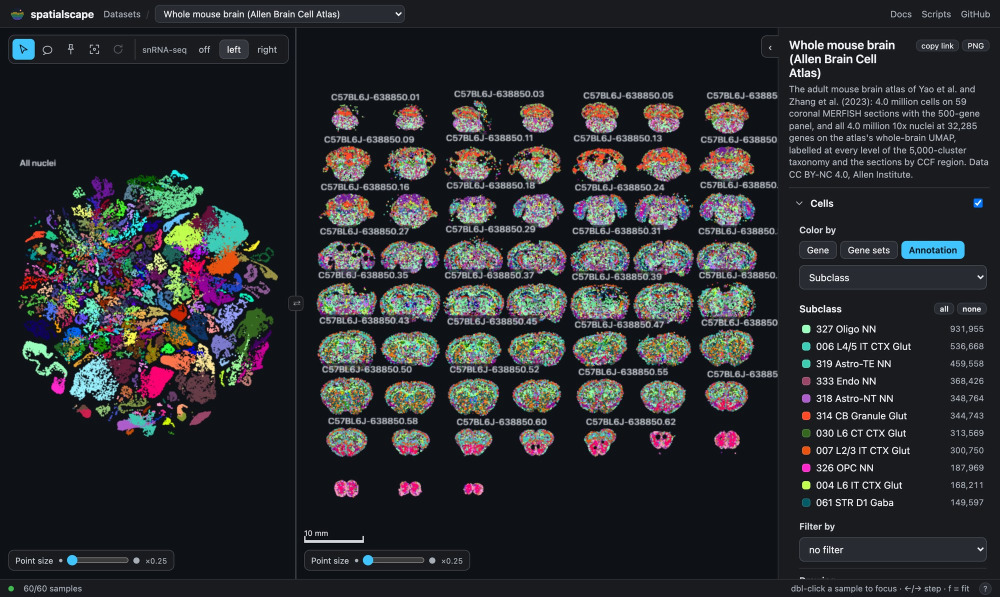
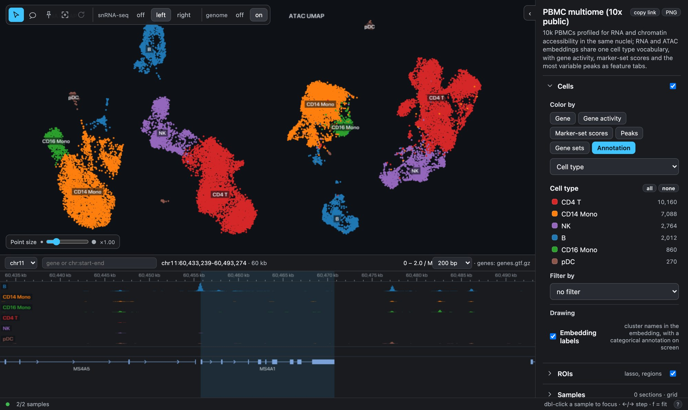
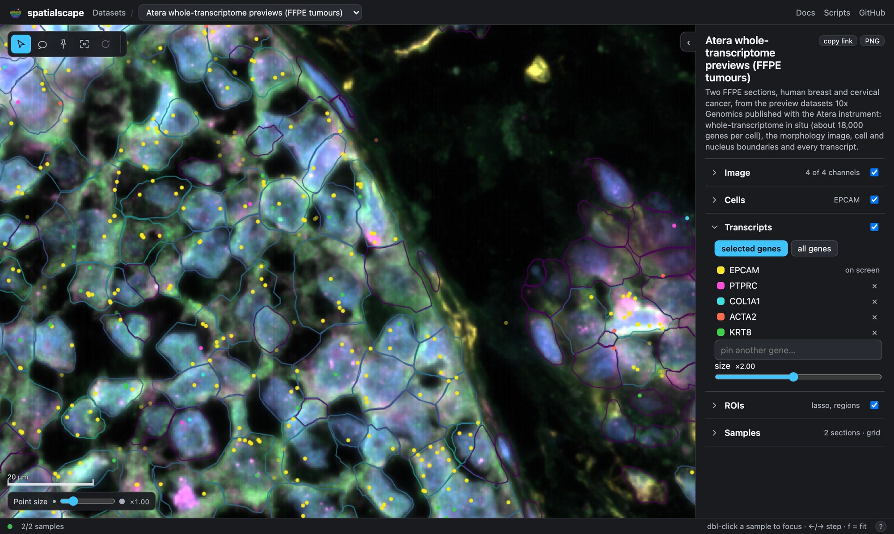

<p align="center">
  <picture>
    <source media="(prefers-color-scheme: dark)" srcset="https://raw.githubusercontent.com/MicTott/spatialscape/main/docs/public/brand/banner-dark.svg">
    
  </picture>
</p>

<p align="center">
  A static, reactive browser for spatial transcriptomics and snRNA-seq.<br>
  One <code>pip install</code> turns a SpatialExperiment or AnnData into a dataset you can open locally or publish as a website.
</p>

<p align="center">
  <a href="https://mictott.github.io/spatialscape/docs/"><b>Documentation</b></a>
  &nbsp;·&nbsp; <a href="https://mictott.github.io/spatialscape/docs/guide/getting-started">Getting started</a>
  &nbsp;·&nbsp; <a href="https://d2lbhik7smmaaj.cloudfront.net">Live examples</a>
  &nbsp;·&nbsp; <a href="CHANGELOG.md">Changelog</a>
</p>

<p align="center">
  <a href="https://github.com/MicTott/spatialscape/actions/workflows/python.yml"></a>
  <a href="https://github.com/MicTott/spatialscape/actions/workflows/app.yml"></a>
  <a href="https://mictott.github.io/spatialscape/docs/"></a>
  
  <a href="LICENSE"></a>
</p>

## Why

Browsing a spatial transcriptomics or snRNA-seq dataset should feel immediate: every section of a study in view at once, a new gene in milliseconds, a link that reopens the exact view, and nothing to run but a static web host. spatialscape is a viewer built for that, and the command line that turns your data into something it can show.

- **Every sample on one canvas.** All sections of a study sit side by side under identical settings. Double-click to focus, step through donors with the arrow keys, switch platforms with one click.
- **Instant.** Expression is stored one byte per cell per gene in sharded Zarr, so a gene is one HTTP range request and a cached switch is a GPU upload. Panning and zooming run at the display's refresh rate because the viewer draws a uniform subsample of the cells at overview zoom and every cell once zoomed in, so what is on screen, not what is in the dataset, sets the frame time; the scripts in `benchmarks/` measure this on any bundle.
- **Linked snRNA-seq.** Paired references render as embeddings beside the tissue with one shared cell type vocabulary, so a color means the same thing everywhere.
- **Nothing to run.** The viewer is files and the data is files. Host them on GitHub Pages, S3, Cloudflare R2 or a lab server; every view state lives in the URL.

## Quick start

```bash
pip install spatialscape
spatialscape synth demo-src                      # two fake sections, an embedding and a dataset.yaml
spatialscape build demo-src/dataset.yaml         # -> demo-src/bundles/synthetic
spatialscape serve demo-src/bundles --open       # viewer + data at http://127.0.0.1:8787/
```

## Your own data

From a folder of your project: a saved R object (`SpatialExperiment` / `SingleCellExperiment` / Seurat with its Visium slices, as `.rds` or `.rda`, parsed in Python, no R needed), AnnData files, a SpatialData store (its shapes, labels, points and images included) or a spatialproteomics object:

```bash
mkdir -p spatialscape && cd spatialscape
spatialscape init ../analysis/spe_dlpfc.rds --id dlpfc --name "Human DLPFC"   # writes ./dlpfc.yaml, a menu of the data, and prints what it assumed
# edit dlpfc.yaml: keep the annotations you want, name them, pick colors and the opening gene
spatialscape build dlpfc.yaml                                                 # -> bundles/dlpfc; rerun after any edit
spatialscape serve bundles --open
spatialscape site build bundles -o site                                       # viewer + gallery + data, ready to upload
```

`init` maps the columns that look like spatial domains, cell types and QC metrics, lists every other column as a comment, and says which platform, coordinate units and layer it took for granted, so most edits are deleting or uncommenting a line. `build` is incremental: a rename or a new palette takes seconds, a re-exported file rebuilds that one sample. For a gallery of several datasets with a title, paper links and "coming soon" cards, `spatialscape site init` writes a `site.yaml` and `spatialscape site build site.yaml` builds it.

```
myproject/
  analysis/spe_dlpfc.rds        your object, never modified
  spatialscape/
    dlpfc.yaml                  yours to edit: samples, annotations, names, colors
    site.yaml                   yours to edit: title, cards, paper links (optional)
    bundles/dlpfc/              the built dataset: upload this to a data host
    bundles/.cache/             R objects converted to AnnData; local only
    site/                       the finished website: upload this
```

The [documentation](https://mictott.github.io/spatialscape/docs/) walks through every step:
[how it fits together](https://mictott.github.io/spatialscape/docs/guide/getting-started#how-it-fits-together),
[writing dataset.yaml](https://mictott.github.io/spatialscape/docs/guide/dataset-yaml),
[making changes](https://mictott.github.io/spatialscape/docs/guide/changes),
[publishing a site](https://mictott.github.io/spatialscape/docs/guide/publish) and the
[CLI reference](https://mictott.github.io/spatialscape/docs/reference/cli/).

## In a notebook or an R session

No yaml, no site: show the object you have in memory, lasso cells, take them back out.

```python
import spatialscape
s = spatialscape.show(adata, color="cell_type")   # builds once into a cache, opens under the cell
cells = s.selection()                              # obs names inside the last lasso
sub = adata[cells]                                 # straight into a DE test
```

From R, `reticulate::py_require("spatialscape")`, one `saveRDS`, and `ss$show("spe.rds")` does the same for a SpatialExperiment ([guide](https://mictott.github.io/spatialscape/docs/guide/notebooks)).

## What it looks like

<p align="center">
  <a href="https://d2lbhik7smmaaj.cloudfront.net/?d=abc-atlas&amp;ps=0.25&amp;pse=0.25&amp;cl=0"></a>
</p>
<p align="center"><sub>Scale: the Allen Brain Cell Atlas of the whole mouse brain, 4.0 million nuclei on their UMAP beside 59 MERFISH sections with another 4.0 million cells.</sub></p>

<p align="center">
  
  <a href="https://d2lbhik7smmaaj.cloudfront.net/?d=atera&amp;v=5039,4729,2.8&amp;c=g:EPCAM&amp;mol=1&amp;mg=PTPRC%7CCOL1A1%7CACTA2%7CKRT8&amp;cs=outlined&amp;msz=2.00"></a>
</p>
<p align="center"><sub>Left, breadth: a 10x multiome, RNA and ATAC UMAPs of the same nuclei over accessibility tracks per cell type. Right, new technology: a whole-transcriptome Atera section of breast cancer, single transcripts over the morphology image and the cell outlines.</sub></p>

## What you get

| In the viewer | In the pipeline |
|---|---|
| Color by gene, by two blended gene sets, by any annotation or by cell type weights | Visium, Visium HD, Xenium, MERFISH and snRNA-seq in one dataset, laid out in microns |
| Filter independently of color: a gene threshold, a QC range, a category | H&E and fluorescence images as OME-Zarr pyramids under the points |
| Hover for every annotation; lasso a region for composition, gene statistics and a CSV of cell ids | Cell boundaries, nucleus boundaries and every transcript at high zoom |
| A dot plot of the current gene by annotation that doubles as a filter | Dataset-level vocabularies: one label, one code, one color across samples and platforms |
| A split view with the snRNA-seq embedding, resizable, left or right | Validation of every bundle, locally and over HTTP (CORS and Range checks) |
| Copy a link to the exact view; export a PNG with legend and scale bar | Incremental builds with a per-sample fingerprint; a conversion cache for R objects |

## How it works

`spatialscape build` writes a *bundle*: a folder of static files holding `manifest.json`, the gene lists and, per sample, a gene-major uint8 expression array (sharded Zarr v3), positions in microns, categorical codes, images, outlines and polygons. The viewer (React 19, deck.gl 9, Viv, zarrita) draws every sample in one WebGL context, decodes in a worker and recolors by uploading one byte per cell. The format is versioned (`formatVersion: 1`) and stable: changes within version 1 only add optional files, `spatialscape validate` is its conformance check, and any Zarr reader can open a bundle without spatialscape. Details: [bundle format](https://mictott.github.io/spatialscape/docs/reference/format), [architecture](https://mictott.github.io/spatialscape/docs/reference/architecture).

## Repository

```
app/       the viewer: Vite + React 19 + TypeScript (deck.gl 9, Viv, zarrita, Zustand)
python/    the spatialscape CLI (anndata, zarr v3, pydantic); the built viewer ships inside the wheel
docs/      the documentation site (VitePress); the CLI pages are generated from the help text
examples/  the synthetic demo and a 10x PBMC multiome config; the public example datasets have their own repository
```

## Development

```bash
git clone https://github.com/MicTott/spatialscape && cd spatialscape
python3 -m venv python/.venv && python/.venv/bin/pip install -e "python[dev]"
npm install
npm run dev                                                   # viewer at http://127.0.0.1:5173
python/.venv/bin/spatialscape serve examples --port 8787      # data; the dev server proxies /examples to it
python/.venv/bin/python -m pytest python/tests && npm test && npm run e2e
```

`npm run build && python/.venv/bin/python python/scripts/bundle_app.py` refreshes the viewer copy inside the package. See [CONTRIBUTING.md](CONTRIBUTING.md).

## Status

Developed at the Lieber Institute for Brain Development, and meant for any lab that wants to put a dataset online next to a paper. Planned: multi-frame compare, named waypoints.

MIT license. Cite with [CITATION.cff](CITATION.cff).
